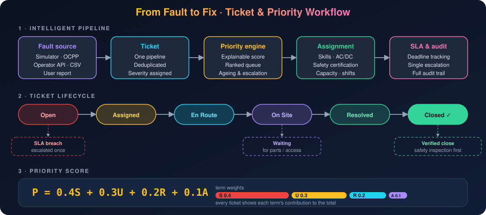
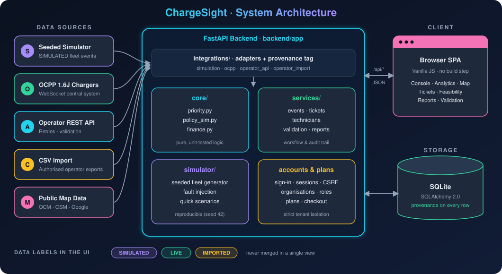

<div align="center">

# ⚡ ChargeSight

### Explainable EV charger operations, repair prioritisation & charging-site investment intelligence

*A multi-organisation SaaS prototype · PME Course (23IS7PCPME) · BMSCE*


[🚀 Quick Start](#-quick-start) · [✨ Features](#-features) · [🏗️ Architecture](#️-architecture) · [🧪 Testing](#-testing) · [🗺️ Map](#️-map--site-planning)

</div>

---

## 📑 Table of Contents

1. [Overview](#-overview)
2. [Quick Start](#-quick-start)
3. [Features](#-features)
4. [Sample Dataset](#-sample-dataset)
5. [Architecture](#️-architecture)
6. [Configuration](#️-configuration)
7. [Testing](#-testing)
8. [Map & Site Planning](#️-map--site-planning)
9. [Real Charger Data](#-real-charger-data)
10. [Financial Model](#-financial-model)

---

## 📌 Overview

**v9** added a public website, secure accounts, organisations with roles and strict data isolation, a central plan catalogue with a simulated (no-payment) checkout, onboarding, and per-organisation operator API / OCPP connections. Design, security controls and migration notes: **[docs/SAAS.md](docs/SAAS.md)**.

### 💳 Plans (proposed prototype prices)

| Plan | Price / month | Notes |
|---|---|---|
| 🆓 **Demo** | ₹0 | Private simulated workspace |
| 🌱 **Starter** | ₹499 | Small fleets |
| 📈 **Growth** | ₹1,499 | Growing operators |
| 🏢 **Professional** | ₹4,999 | Reports and audit log |
| 🤝 **Enterprise** | By quotation | Negotiated limits |

> Checkout is **simulated**: no payments, invoices or tax.

---

## 🚀 Quick Start

**Requirements:** 🐍 Python 3.10+ and internet for the first install. No Node.js or database server needed.

### 🪟 Windows

1. Install Python from <https://www.python.org/downloads/> and tick **"Add python.exe to PATH"**.
2. Double-click **`run.bat`**, or:
   ```bat
   cd %USERPROFILE%\Desktop\EV-ChargeSight-Platform
   run.bat
   ```
3. Open 🌐 <http://127.0.0.1:8000> (public site) or 🖥️ <http://127.0.0.1:8000/app> (console, sign-in required).

The first run creates `.venv`, installs dependencies, copies `.env.example` to `.env`, creates the SQLite database and builds the **synthetic sample dataset** (~10 s).

**First time on an existing database (v9):** create your developer account (platform admin that owns the sample workspace):
```powershell
python scripts\manage.py create-admin --email you@example.com --name "Your Name"
```

### 💻 PowerShell in VS Code
```powershell
cd "$env:USERPROFILE\Desktop\EV-ChargeSight-Platform"
python -m venv .venv                       # first time only
.\.venv\Scripts\Activate.ps1               # if blocked: Set-ExecutionPolicy -Scope Process Bypass
python -m pip install -r requirements.txt  # first time, and after pulling changes
python scripts\manage.py create-admin --email you@example.com --name "Your Name"   # first time on v9
python run.py                              # site: http://127.0.0.1:8000  |  console: /app
python -m pytest -q                        # tests (second terminal, venv activated)
```

### 🍎🐧 macOS / Linux
```bash
cd ~/Desktop/EV-ChargeSight-Platform
chmod +x run.sh test.sh
./run.sh
```

### 🔧 Manual (any OS)
```bash
python -m venv .venv
# Windows: .venv\Scripts\activate     macOS/Linux: source .venv/bin/activate
pip install -r requirements.txt
python run.py
```

### 🔌 Separate terminals (Dashboard + OCPP)

| Terminal | Purpose | Command (after activating `.venv`) |
|---|---|---|
| 1️⃣ | Dashboard | `python run.py` |
| 2️⃣ | OCPP central system | `cd backend; python -m app.integrations.ocpp_central` |
| 3️⃣ | OCPP test charge point (SIMULATED) | `python scripts\ocpp_simulator.py --id SIMOCPP-001` |

Stop with **Ctrl+C**; data lives in `data/chargesight.db` and survives restarts. Details: [docs/INTEGRATION.md](docs/INTEGRATION.md).

### 🔐 Sign in & sign up

- The header offers **Sign in**, **Sign up** and **Open workspace**; when signed in it shows *Signed in as …* and **Sign out**.
- `/app` redirects to Sign in server-side without a valid session; only `/app…` destinations are accepted afterwards (no open redirects).
- **Start free demo** (`/demo`) never signs anyone in silently: sign up or sign in first, then your private simulated workspace opens. There is no shared or anonymous account.

### 🗂️ Workspaces

| Workspace | What it is | How to open |
|---|---|---|
| 🧑‍💼 **My Fleet** | Your own records only; nothing synthetic is added. The empty state offers *Import an authorised CSV* and *Configure operator API or OCPP* | Default |
| 🎬 **Presentation Demo** | Separate SIMULATED workspace: 6 sites, 40 chargers, technicians, 6 h of history and 8 tickets (first build ~15–60 s) | Sidebar → *Workspace* → **Open Presentation Demo** |

### ♻️ Reset / restore

| Action | Effect |
|---|---|
| **Operations console → Reset / restore** (type `RESET`) | Rebuilds the sample data. Deletes only SIMULATED events, tickets and telemetry; imported/live records and your own runs/sites are kept |
| **Simulator → Reset simulation** | Clears simulated activity to an empty run |
| **Full wipe** | Stop the server, delete `data/chargesight.db*`, start again |

Existing v1 databases are upgraded in place (nothing is dropped).

---

## ✨ Features

| | Module | Where in the app | Status |
|---|---|---|---|
| 📊 | **Operations console**: uptime %, status counts, tickets (open/critical/overdue), energy, sessions, power, MTTA/MTTR, critical alerts, charger panel, site health, timeline, quick scenarios | Fleet dashboard | ✅ |
| 📈 | **Analytics**: trend charts (status, faults, power, energy, sessions, MTTA/MTTR, ticket age, backlog, site uptime, FIFO vs priority, investment) | Analytics | ✅ |
| 🎲 | **Event & fault simulator**: seeded, start/pause/reset/step, fault injection, event log | Simulator & events | ✅ |
| 🎫 | **Maintenance tickets**: *Raise a Ticket*, one pipeline for user, simulator, OCPP, operator API and imported sources; lifecycle Open → Assigned → En Route → On Site → Resolved → Closed; SLA escalation; audit trail; export | Maintenance tickets | ✅ [docs/TICKETING.md](docs/TICKETING.md) |
| 🧑‍🔧 | **Technician registry** with automatic/manual assignment (skills, AC/DC, safety certification, capacity, shifts) | Technicians | ✅ |
| 🧮 | **Priority engine** `P = 0.4S + 0.3U + 0.2R + 0.1A` (explainable) | Priority engine | ✅ |
| ⚖️ | **FIFO vs priority** policy simulation with paired 95% CIs and sensitivity analysis | Repair policy lab | ✅ |
| 🗺️ | **Google Maps** visualisation with OpenStreetMap fallback | Map | ✅ |
| 🔌 | **Real charger integration**: REST adapter, CSV import, OCPP 1.6J central system | Data integrations | ✅ |
| 💰 | **Site investment feasibility** with scenarios and site comparison | Site feasibility | ✅ |
| ✔️ | **Validation workflow**: interviews, historical data, retrospective replay, evidence-gated status | Validation | ✅ |
| 📄 | **Reports** and CSV/HTML exports with provenance metadata | Reports & exports | ✅ |

### 🎭 Quick scenarios (Operations console)

`Normal operations` · `Critical fault burst` · `Site connectivity outage` · `High demand` · `Maintenance backlog` · `Recovery demonstration` · `Repair policy comparison`

Each scenario changes real simulator state. The console shows the scenario name, source, start time, Running/Paused state and Start/Resume, Pause, Step and Reset controls.

### 🔗 API highlights

| Endpoint | Purpose |
|---|---|
| `GET /api/analytics/timeseries\|faults\|maintenance\|sites` | Analytics data |
| `GET /api/chargers/{id}/readings` | Per-charger readings |
| `GET /api/timeline` | Events + ticket lifecycle (filters: `site, charger, type, severity, q, operational`; `limit/offset`) |
| `POST /api/sim/inject` | Fault injection (optional `severity`, `note`) |
| `GET /api/tickets` | Supports `q`, `technician`, `sort=priority\|severity\|age\|status\|newest` |

More: [ARCHITECTURE](docs/ARCHITECTURE.md) · [METRICS](docs/METRICS.md) · [ASSUMPTIONS](docs/ASSUMPTIONS.md) · [AUDIT](docs/AUDIT.md).

### 🔄 Ticket workflow



---

## 🎬 Sample Dataset

Built deterministically (seed 42) from the live simulator, covering **02:00–08:00 IST**: 40 chargers at 6 sites, real engine sessions, heartbeats and meter values, and 8 scripted ticket stories.

| Ticket | Charger | Story |
|---|---|---|
| `TKT-00001` | SIM-YLK-02 ground fault | 🔴 Open, **overdue** critical |
| `TKT-00002` | SIM-HSR-03 overcurrent | ✅ Assigned → en route → on site → resolved with notes |
| `TKT-00003` | SIM-KRM-06 reader failure | ✅ Closed by successful remote reset |
| `TKT-00004` | SIM-HBL-03 comm loss | 🔴 Offline, remote reset failed, open |
| `TKT-00005` | SIM-ECY-03 high temperature | 🛠️ Technician on site (connector stays hot) |
| `TKT-00006` | SIM-WFD-03 overcurrent | 🚗 Technician en route |
| `TKT-00007` | SIM-YLK-04 reader failure | ⚠️ Reset failed, assigned |
| `TKT-00008` | SIM-KRM-01 ground fault | 🔥 Fresh critical, **rank 1** |

It also includes two policy experiments and two investment sites. Seeding runs once, never duplicates and never touches non-simulated data.

---

## 🏗️ Architecture



Every site, charger, event and ticket carries a `source` of `simulation`, `operator_api`, `ocpp` or `operator_import`. The UI labels these **SIMULATED**, **LIVE** or **IMPORTED** and never merges them in one view.

---

## ⚙️ Configuration

Copy `.env.example` to `.env` (the start scripts do this). Everything is optional.

| Variable | Purpose |
|---|---|
| `HOST`, `PORT` | Server address (default `127.0.0.1:8000`) |
| `DATABASE_URL` | Default `sqlite:///data/chargesight.db` |
| `SIM_SEED`, `SIM_STEP_SECONDS`, `SIM_TICK_MS`, `SIM_AUTOSTART` | Live simulator |
| `GOOGLE_MAPS_BROWSER_KEY`, `GOOGLE_MAPS_MAP_ID` | Google Maps (restrict the browser key) |
| `GOOGLE_PLACES_API_KEY` | Google Places API (New), server-side, live lookup only |
| `OSM_ENABLED`, `OSM_OVERPASS_URL` | OpenStreetMap listings via Overpass (no key) |
| `PUBLIC_SNAPSHOT_AUTOLOAD` | Load the bundled Open Charge Map Bengaluru snapshot |
| `OCM_API_KEY` | Open Charge Map (server-side) |
| `OPERATOR_API_BASE_URL`, `OPERATOR_API_KEY`, `OPERATOR_API_TIMEOUT_S`, `OPERATOR_API_MAX_RETRIES` | Authorised operator REST API |
| `OCPP_HOST`, `OCPP_PORT` | Optional OCPP 1.6J central system |
| `ADMIN_TOKEN` | Enables administrative override of the ticket workflow |

🔒 Secrets stay on the server and are redacted from logs, API responses and exports (covered by a test).

---

## 🧪 Testing

```bash
python -m pytest -q      # 397 tests, ~20 min (25 use headless Playwright; skipped if not installed)
```

| 🧩 Area | Test files | What is verified |
|---|---|---|
| 🔐 **Auth** | `test_v9_auth.py` | Sign-up, Argon2id hashes, generic credential errors, session expiry, CSRF, rate limits, password reset, no secrets in logs |
| 🏢 **Tenancy** | `test_v9_tenancy.py` | Cross-organisation isolation, roles (viewer/technician/admin/owner), platform-admin-only endpoints |
| 💳 **Billing** | `test_v9_billing.py`, `test_v9_pricing_migration.py`, `test_v92_checkout.py` | Plan catalogue, Decimal rounding, idempotent checkout, no card data stored, plan limits, migration safety |
| 🚪 **Onboarding & integrations** | `test_v9_onboarding_integrations.py` | Not configured / Connected states, SSRF blocking, encrypted secrets, per-org OCPP endpoints |
| 🗂️ **Workspaces** | `test_v92_workspaces.py` | Populated presentation workspace, no leaks between users |
| 🌐 **Auth routes** | `test_v101_auth_routes.py`, `test_browser_v101.py` | Header actions, server redirect, safe redirect parameter |
| 🎯 **Priority & simulation** | `test_priority.py`, `test_simulation.py`, `test_policy_sim.py` | Scoring, ranking, reproducibility, FIFO vs priority metrics |
| 🎫 **Tickets** | `test_tickets.py`, `test_ticketing.py` | Lifecycle, SLA, assignment constraints, overrides, dedup, migration |
| 💰 **Finance** | `test_finance.py` | Revenue, payback, NPV/IRR, loss-making and invalid cases |
| 🔌 **Integrations** | `test_integrations.py`, `test_live_integrations.py` | Retries, timeouts, dedupe, real local OCPP 1.6J WebSocket handshake |
| 📍 **Stations & map** | `test_public_stations.py`, `test_map_localities.py`, `test_planning.py`, `test_planning_scoring.py` | Snapshot accuracy, STATUS UNKNOWN labelling, coordinates, ranking, sensitivity |
| 🖥️ **Browser (Playwright)** | `test_browser_map.py`, `test_browser_v92.py`, `test_browser_saas.py` | Landing/pricing, responsive layout, checkout flow, tenant isolation in UI, map interactions |
| 🧱 **App** | `test_app.py` | Start-up, seed, endpoints, restore safety, exports |

---

## 🗺️ Map & Site Planning

### 🔍 Explore

Seven locality cards (**All Bengaluru, Whitefield, Electronic City, HSR Layout, Koramangala, Hebbal, Yelahanka**, plus *Other Bengaluru*) show listing counts, operators, DC connectors and freshness, all computed from the database. Selecting a card updates markers, list, summary and charts together. Every public listing shows **STATUS UNKNOWN**. Deep links like `#map?area=hebbal` restore the view.

A zero is labelled **true zero** only after a successful full-area provider refresh; with only the snapshot it is **coverage unknown**.

### 🎛️ Controls

Search (station, operator, locality, `lat, lng`, address via Google Geocoding) · map types · photorealistic 3D · tilt/rotate · North up · Reset camera · Fit locality/visible · Street View · coordinate readouts · legend. Without a Google key, OpenStreetMap tiles (or an offline coordinate plot) are used.

### 📌 Plan, rank & compare

| Step | What happens |
|---|---|
| 1️⃣ **Plan** | Click the map, type coordinates or search; validated against the Bengaluru study area; nearest chargers and counts within 0.5/1/2/5 km |
| 2️⃣ **Save candidate** | Stored separately from listings and proposed sites; record chargers, type, power, budget, sessions/day, grid capacity, etc.; optional OSM context (≤500 m) |
| 3️⃣ **Feasibility** | *Continue to Site Feasibility* prefills only entered values with their sources; saving always asks first |
| 4️⃣ **Rank** | Explainable weighted score with evidence classes (`SOURCE DATA`, `USER-ENTERED`, `ASSUMPTION`, `ESTIMATED`, `MISSING`), confidence and sensitivity; *Insufficient data to rank reliably* when evidence is thin |
| 5️⃣ **Compare** | NPV, IRR, payback, break-even demand and utilisation under identical assumptions |

### 📚 Data sources

| Source | Key needed | Behaviour |
|---|---|---|
| Open Charge Map (CC BY 4.0) | `OCM_API_KEY` | 41-listing bundled snapshot (copied 23 Oct 2026); explicit, throttled refresh |
| OpenStreetMap / Overpass | None | Explicit, throttled, deduplicated |
| Google Places API (New) | `GOOGLE_PLACES_API_KEY` | Shown, never stored, only after billing confirmation |

Setup, licences, costs: [docs/GOOGLE_MAPS.md](docs/GOOGLE_MAPS.md) · Method and weights: [docs/PLANNING.md](docs/PLANNING.md).

---

## 🔌 Real Charger Data

| Capability | Status |
|---|---|
| 📥 **CSV import** of authorised operator exports (validated, deduplicated, `operator_import`) | ✅ Works |
| 🌐 **Operator REST adapter** (timeouts, retries, validation) | ✅ Needs base URL, API key and usually a small mapping change in `integrations/operator_api.py` |
| 📡 **OCPP 1.6J central system** | ✅ Real WebSocket flow: BootNotification → StatusNotification(Faulted) → ticket |

Nothing is marked "connected" until a real handshake or verified response happens. See [docs/INTEGRATION.md](docs/INTEGRATION.md).

---

## 💰 Financial Model

`backend/app/core/finance.py` documents every formula: initial investment, energy, gross revenue, electricity and variable costs, gross margin, fixed opex, operating contribution (pre-tax cash flow), cumulative cash flow, simple payback, NPV, IRR, break-even sessions/day and implied utilisation. Loss-making, unreachable-payback and impossible-utilisation cases are flagged.

> The Validation page compares estimates with real reference values once supplied, and shows **NOT YET VALIDATED** until then.

---

<div align="center">

**⚡ ChargeSight** · Academic prototype for PME (23IS7PCPME), B.M.S. College of Engineering, Bengaluru
*Built with FastAPI, SQLAlchemy and vanilla JavaScript*

</div>
